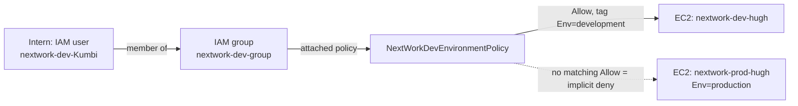
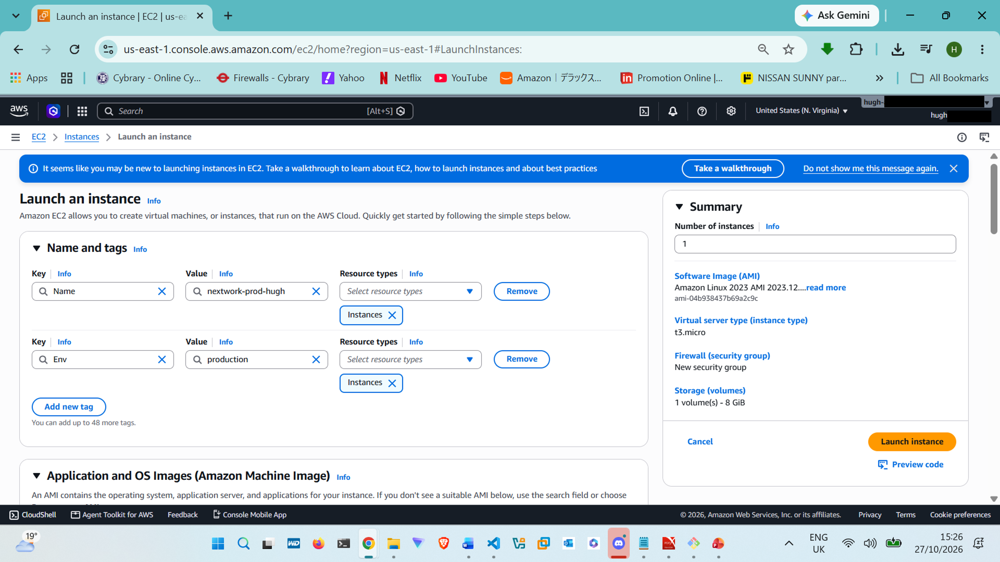
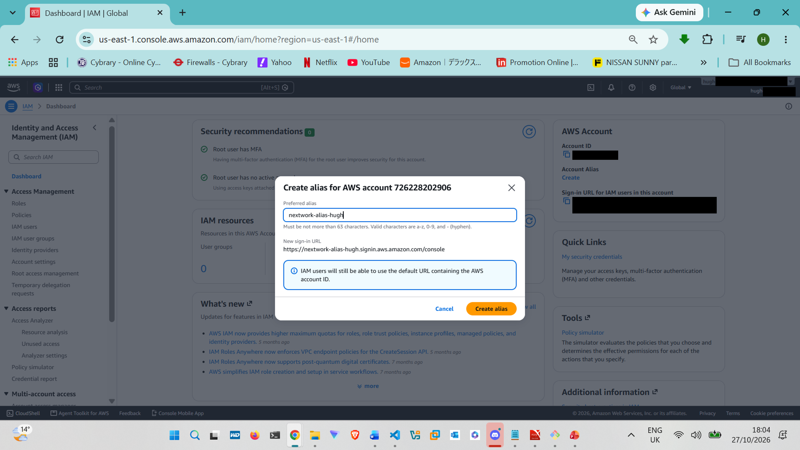
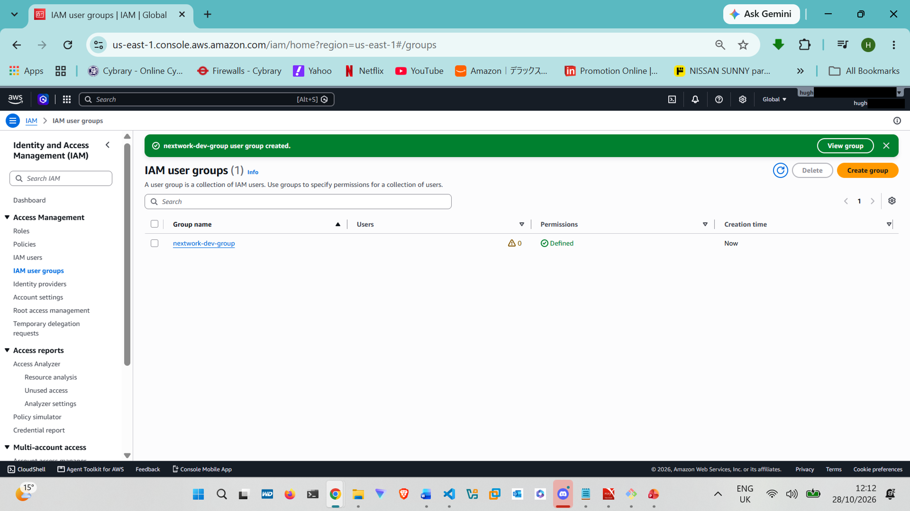
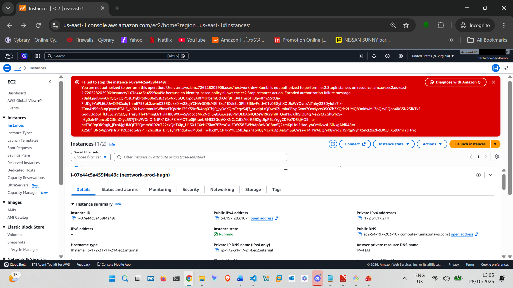
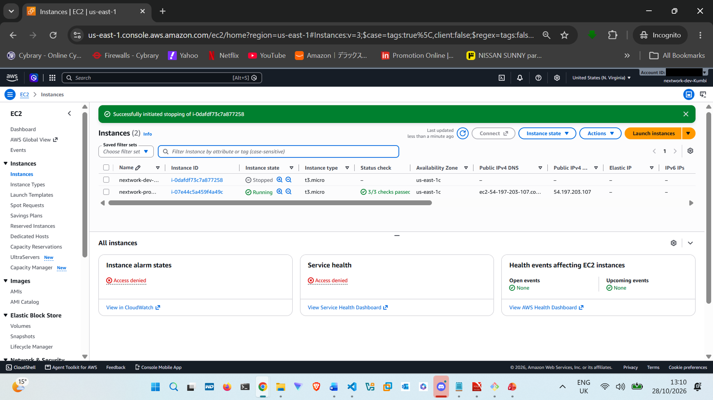

# 01. Cloud Security with AWS IAM: Least Privilege for a Dev/Prod Split

> Restricted a new intern to the development EC2 environment only, using tag-based IAM policies, a user group, and a dedicated IAM user. Then proved the boundary works by testing it two ways: a live login and the IAM Policy Simulator.

**NextWork Pathway:** Cloud SecOps and Threat Monitoring | Week 1: Hardening the Baseline
**Time taken:** about 1 hours 30 minutes
**Region:** `US East (N. Virginia)`

---

## Objective

Working in AWS with root credentials, or giving every person broad access, is a compliance failure and a major compromise risk. The fix is to give each person a separate identity with only the permissions their job needs.

An organization has a production and a development environment on EC2. A new intern needs to work in development, but must not be able to stop, modify, or retag anything in production. This project implements that boundary with the principle of least privilege and then verifies it.

## Architecture



## Services and concepts

| Service / concept | How it was used |
|-------------------|-----------------|
| Amazon EC2           | Two instances: one production, one development                   |
| Resource tags        | `Env=production` and `Env=development` drive the access decision |
| IAM policy (JSON)    | Custom policy with tag-based conditions and an explicit Deny     |
| IAM user group       | Permissions attached once to the group, not to individual users  |
| IAM user             | Console-enabled login for the intern                             |
| Account alias        | Friendly sign-in URL for the account                             |
| IAM Policy Simulator | Tested permissions without touching live resources               |

---

## What I built

### 1. Launched two tagged EC2 instances

| Name | Tag |
|------|-----|
| `nextwork-prod-hugh` | `Env = production`  |
| `nextwork-dev-hugh`  | `Env = development` |

Both used AMI `<AMI name>` and instance type `<instance type>`, with no key pair (not needed for console-only access in this lab). This was done on a pay-as-you-go account, so I chose a small, low-cost instance type and terminated both instances straight after testing.




### 2. Created the IAM policy

Full file: [`policies/NextWorkDevEnvironmentPolicy.json`](policies/NextWorkDevEnvironmentPolicy.json)

| Statement | Effect | What it does |
|-----------|--------|--------------|
| 1 | Allow `ec2:*` where `ec2:ResourceTag/Env = development`  | Full control, but only over development-tagged EC2 resources |
| 2 | Allow `ec2:Describe*` on all resources                   | Read-only visibility, so the console can list instances      |
| 3 | Deny `ec2:CreateTags`, `ec2:DeleteTags` on all resources | Prevents changing tags                                       |

**Why statement 3 matters:** access here depends on tags. Without the Deny, the intern could retag the production instance as `Env=development` and then gain full control of it. An explicit Deny always overrides any Allow, so this closes that privilege escalation path.

**Why production is protected:** there is no Allow for production resources, so AWS's default implicit deny applies.


> Note: the policy description field rejected an apostrophe, so I removed it to create the policy.

### 3. Created an account alias

Replaced the account-ID sign-in URL with a friendlier alias: `nextwork-alias-hugh`.




### 4. Created the group and user

- Group `nextwork-dev-group` with `NextWorkDevEnvironmentPolicy` attached
- User `nextwork-dev-Kumbi` with console access, added to the group (no direct policy attachment)




! [IAM user created](../screenshots/29-iam-user-create.png)


---

## Testing and results

A full list of screenshots and what each one proves is in [`docs/evidence.md`](docs/evidence.md).

### Test A: live login as the intern

| Action | Resource | Result |
|--------|----------|--------|
| View console dashboard panels | n/a                  | Access denied (no permissions granted)       |
| Stop instance                 | `nextwork-prod-hugh` | **Denied**: not authorized                   |
| Stop instance                 | `nextwork-dev-hugh`  | **Allowed**: instance entered Stopping state |





### Test B: IAM Policy Simulator (non-disruptive)

Testing by stopping a real instance is disruptive in a real environment, so I re-tested with the simulator against `nextwork-dev-group`.

| Action | Resource scope | Result | Why |
|--------|----------------|--------|-----|
| `ec2:DeleteTags`    | `*`                            | Denied      | Matched the explicit Deny statement                                |
| `ec2:StopInstances` | `*` (default)                  | Denied      | Allow only applies when the `Env=development` tag condition is met |
| `ec2:StopInstances` | tag `Env=development` supplied | **Allowed** | Condition satisfied                                                |

The simulator's "Show statement" view identified exactly which policy statement caused each decision.


---

## Key concepts demonstrated

- **Policy evaluation logic.** Everything is denied by default (implicit deny). An explicit Allow grants access. An explicit Deny always overrides any Allow. Here, production is protected by implicit deny (no Allow matches it), and tags are protected by an explicit Deny.
- **Identity-based vs resource-based policies.** Identity-based policies, like the one in this project, are attached to a user, group or role and define what that identity can do. Resource-based policies, like S3 bucket policies, are attached to the resource and define who can access it. This project used an identity-based policy attached to a group.
- **Groups over individual users.** Attaching the policy to a group means every future intern inherits the same permissions automatically.

## Security review and improvements

What I would change for a production-grade setup:

1. **Narrow `ec2:*`.** It allows far more than an intern needs (for example, terminating instances or modifying security groups). A tighter policy would list only `ec2:StartInstances`, `ec2:StopInstances`, and `ec2:RebootInstances`.
2. **Require password reset and MFA.** I unchecked "must create a new password" only to keep the lab simple. Real users should be forced to reset and use MFA.
3. **Prefer IAM Identity Center** over long-lived IAM users for people.
4. **Use attribute-based access control (ABAC)** with principal tags so one policy scales across many teams and environments.
5. **Add a permissions boundary** to cap the maximum permissions any policy can grant.
6. **Audit with CloudTrail** to log every action the intern takes (built in Project 3).

## Challenges and lessons learned

- **Reading the policy.** Multiple statements with a condition and an explicit Deny were hard at first. Breaking it into one statement at a time made the logic clear.
- **Allow vs. Deny evaluation.** Default is implicit deny, an explicit Allow grants access, and an explicit Deny always wins.
- **Simulator "denied" confusion.** `StopInstances` showed denied until I supplied the `development` tag, because the Allow is conditional. This taught me that conditions must be satisfied by the request context.
- **Tags are a security control**, not just labels, which is why protecting them with a Deny matters.

## Cost

This account is pay-as-you-go (no free tier), so the only billable resources were the two EC2 instances, which ran for roughly `1` hour `30` minutes. IAM users, groups, policies and the account alias are free. Estimated cost: `$0.80`.

## Cleanup

Because this account is on pay-as-you-go billing, I deleted everything immediately after testing to keep costs minimal: both EC2 instances, `nextwork-dev-group`, user `nextwork-dev-Kumbi`, `NextWorkDevEnvironmentPolicy`, and the account alias.

## Skills demonstrated

`IAM policy authoring` · `least privilege` · `tag-based access control` · `explicit vs implicit deny` · `user and group management` · `IAM Policy Simulator` · `EC2 fundamentals`

## Folder contents

```
01-iam-least-privilege/
├── README.md
├── policies/
│   └── NextWorkDevEnvironmentPolicy.json
├── screenshots/
└── docs/
    └── evidence.md
```