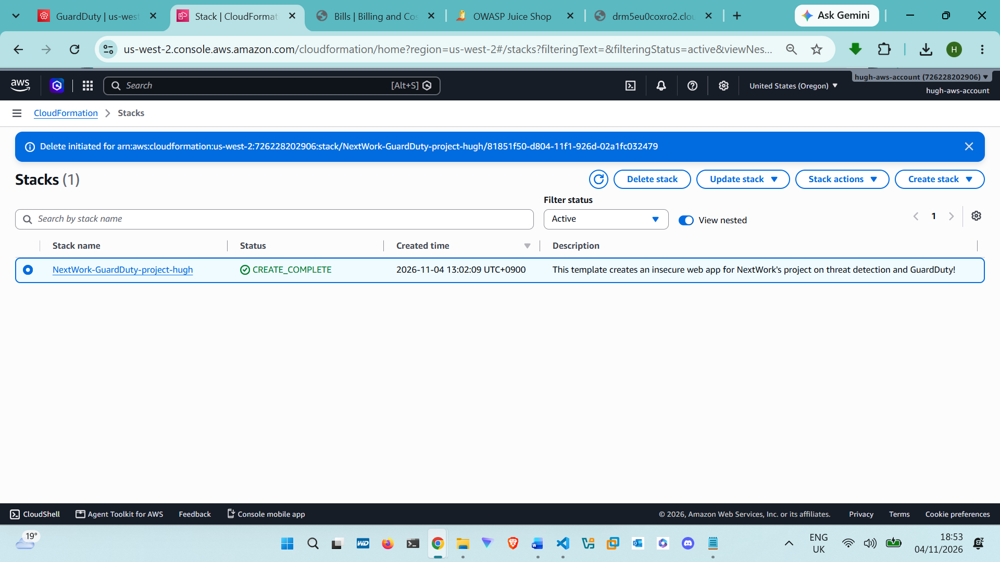
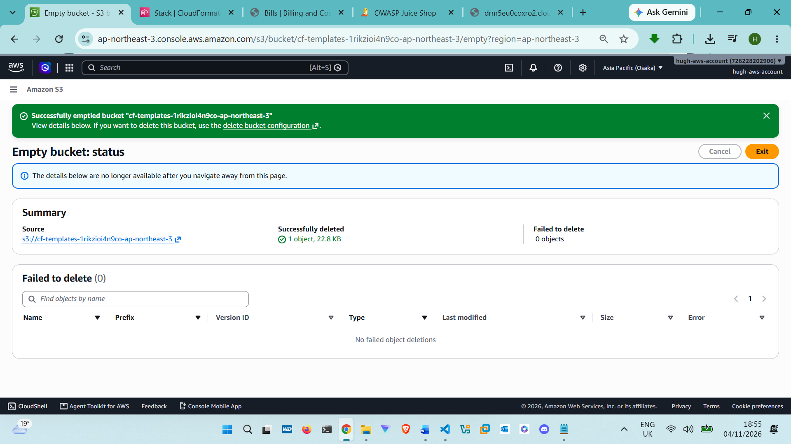
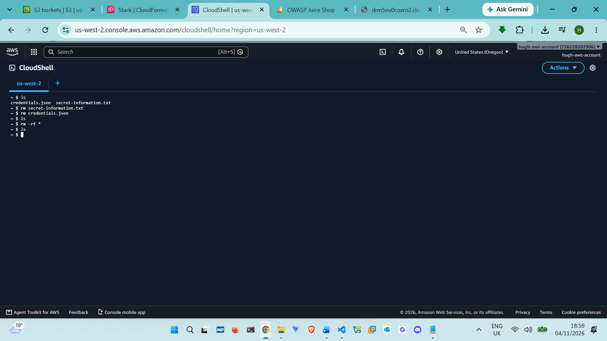

# Incident Report: Instance Credential Exfiltration and S3 Data Access

**Classification:** Lab exercise (OWASP Juice Shop, self-contained CloudFormation deployment). No production systems or real customer data were involved.  
**Severity:** High  
**Status:** Resolved. Environment deleted after investigation   
**Evidence:** screenshots referenced below are indexed in [`evidence.md`](evidence.md)  

---

## 1. Summary

An attacker (performed by me, as part of this lab) exploited an SQL injection to bypass authentication, then a command injection to execute arbitrary code on the web application's EC2 host. The command injection exfiltrated the instance's temporary IAM credentials to a public path, after which the attacker used those credentials from AWS CloudShell to retrieve a file from a private S3 bucket. Amazon GuardDuty detected the misuse of the instance's credentials from an unrelated AWS account.

## 2. Timeline

| Time (relative) | Event | Evidence |
|-----------------|-------|----------|
| T+0       | Attacker submits `' or 1=1;--` as the email on the login form and logs in as admin without valid credentials                                           | [`12-sql-injection-login-field.png`](../screenshots/12-sql-injection-login-field.png), [`13-sql-injection-success-banner.png`](../screenshots/13-sql-injection-success-banner.png) |
| T+2 min   | Attacker accesses admin profile page to inject a JavaScript payload into the Username field                                                            | [`14-admin-profile-page.png`](../screenshots/14-admin-profile-page.png) |
| T+2 min   | Web server executes the payload (command injection), queries the EC2 instance metadata service, and writes IAM credentials to a public path in the app | [`15-command-injection-object-object.png`](../screenshots/15-command-injection-object-object.png) |
| T+3 min   | Attacker retrieves `credentials.json` directly over HTTP                                                                                               | [`16-stolen-credentials-json.png`](../screenshots/16-stolen-credentials-json.png) |
| T+5 min   | Attacker opens AWS CloudShell, configures a CLI profile (`stolen`) using the retrieved credentials                                                     | [`17-cloudshell-first-open.png`](../screenshots/17-cloudshell-first-open.png), [`18-cloudshell-env-vars.png`](../screenshots/18-cloudshell-env-vars.png), [`19-cloudshell-wget-credentials.png`](../screenshots/19-cloudshell-wget-credentials.png), [`20-cloudshell-cat-jq-credentials.png`](../screenshots/20-cloudshell-cat-jq-credentials.png), [`21-cloudshell-aws-configure-profile.png`](../screenshots/21-cloudshell-aws-configure-profile.png) |
| T+6 min   | Attacker runs `aws s3 cp` to copy `secret-information.txt` from the target S3 bucket                                                                   | [`22-cloudshell-s3-cp-secret-file.png`](../screenshots/22-cloudshell-s3-cp-secret-file.png) |
| T+6 min   | Attacker reads the file, confirming data exposure                                                                                                      | [`23-cloudshell-secret-file-contents.png`](../screenshots/23-cloudshell-secret-file-contents.png) |
| T+~20 min | GuardDuty generates finding `UnauthorizedAccess:IAMUser/InstanceCredentialExfiltration.InsideAWS` (High severity)                                      | [`24-guardduty-findings-list.png`](../screenshots/24-guardduty-findings-list.png) |
| T+21 min  | Defender (me) reviews the finding in the GuardDuty console                                                                                             | [`25-guardduty-finding-detail.png`](../screenshots/25-guardduty-finding-detail.png) |

## 3. Root cause

Two unrelated input-validation failures, chained together:

1. **Authentication bypass (SQL injection):** the login endpoint built a database query from unsanitized user input, so a crafted string could make the query always evaluate to true.
2. **Remote code execution (command injection):** the profile update endpoint passed the Username field to the server without sanitization, allowing arbitrary JavaScript (and by extension, OS-level commands) to execute on the host.

Neither flaw alone would have been catastrophic. Together, they gave the attacker code execution, and from there, access to the EC2 instance's IAM role credentials via the instance metadata service.

## 4. Impact

- Unauthorized read access to one object in a private S3 bucket (`secret-information.txt`)
- Full exposure of the EC2 instance role's temporary credentials for the life of their validity window
- In a real deployment, the impact would scale with whatever permissions the instance role held, potentially far beyond one S3 object

## 5. Detection

**Finding:** `UnauthorizedAccess:IAMUser/InstanceCredentialExfiltration.InsideAWS`

GuardDuty's anomaly detection identified that credentials issued to an EC2 instance role were being used by a different AWS account ID (CloudShell's temporary session account) rather than the instance itself. This is the indicator GuardDuty alerted on, not the specific S3 `GetObject` call, which in isolation looks like normal application behavior.

**Evidence captured:**
- Resource affected: IAM role attached to the EC2 instance
- API action: `GetObject`
- Actor: source IP address and approximate geographic location of the CloudShell session

## 6. Response actions taken

1. Confirmed the finding details and the affected resource in the GuardDuty console
2. Treated the exposed credentials as compromised (they were temporary and tied to a lab resource that was deleted)
3. Deleted the CloudFormation stack, which removed the EC2 instance, its IAM role, the S3 bucket, and associated networking

4. Removed locally cached copies of the stolen credentials and the exfiltrated file from CloudShell and local storage 

## 7. Recommendations

| Recommendation | Why |
|----------------|-----|
| Sanitize and parameterize all user input (queries and free-text fields alike) | Closes both the SQL injection and command injection vectors at the source |
| Enforce IMDSv2 and consider IMDS hop-limit restrictions | Reduces the chance that server-side request forgery or command injection can reach instance metadata |
| Scope the instance role to only the S3 actions and resources it actually needs | Limits blast radius if credentials are stolen again |
| Alert on `InstanceCredentialExfiltration` findings with automated response (for example, an EventBridge rule that revokes the role's active session) | Shortens the window between detection and containment. **Note:** this lab's own CloudFormation template already includes exactly this pipeline (EventBridge → Step Functions → `iam:PutRolePolicy`), discovered by reading `templates/nextwork-guardduty-setup.yaml` after the fact. See the README's "Discovery" section. |
| Avoid writing any credential or secret material to a web-servable path, even temporarily | The public write is what turned a local compromise into a remote one |

## 8. Lessons learned

The most important finding here isn't the GuardDuty alert itself, it's that an identity-centric detection (credentials used from an unexpected account) caught an attack that a resource-centric detection (watching the S3 bucket alone) might have missed or only caught too late. Defense that accounts for *who* is making a call, not just *what* the call does, closes a real gap.
